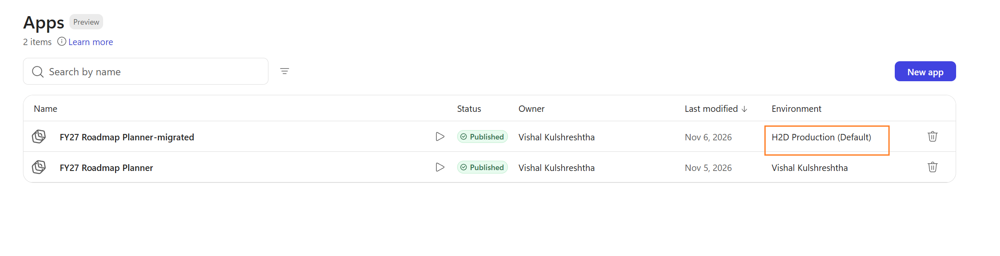

# Copilot Code ALM Migration (Local Mode)

Migrate a Microsoft Copilot Managed Runtime app from one environment to another using a repeatable ALM flow in Copilot Code.

## Why this is required (ALM context)

Environment-to-environment migration is a core ALM need:

- promote apps from personal/dev to test/uat/prod
- keep migration steps consistent and auditable
- reduce manual mistakes in app setup and dependency recreation
- validate dependencies (data sources/connectors/settings) before deploy

This package gives a **check-first** process so you can preview everything before execution.

## What this package contains

- `.github/prompts/alm-migrate.prompt.md`  
  Reusable Copilot prompt with migration policy and guardrails.
- `scripts/ms-app-alm-migrate.ps1`  
  Local execution script (`check-only` and `execute`).
- `.github/workflows/copilot-setup-steps.yml`  
  Optional setup workflow for cloud-agent sessions.
- `INSTALL-STEPS.md`  
  Copy/paste install and run instructions.

## Local mode prerequisites

1. Node.js + npm installed
2. Managed Apps CLI installed:
   ```bash
   npm install -g @microsoft/managed-apps-cli
   ```
3. Signed in:
   ```bash
   ms auth login
   ms auth status
   ```
4. Copilot Code running in the repository where you add this package

## How to use in Copilot Code (local mode)

### Option A: Prompt-driven (recommended)

Use this chat instruction:

```text
Use .github/prompts/alm-migrate.prompt.md.

Run ALM migration in check-only mode first.
App identifier: <app name or app id>
Target environment ID: <target env id>
Source environment ID: <optional; auto-detect from personal dev/default if not provided>
Target app name: <optional>

Include dependency migration plan for all data sources and app settings.
Do not execute deploy steps until I confirm.
```

Then execute after review:

```text
Now execute the same migration plan.
Stop on first failure and show the exact failing command.
Ask for confirmation before create/build/deploy.
```

### Option B: Script-driven

Run preview:

```powershell
pwsh ./scripts/ms-app-alm-migrate.ps1 `
  -AppIdentifier "<app name or app id>" `
  -TargetEnvironmentId "<target-env-guid>" `
  -Mode check-only
```

Run execution:

```powershell
pwsh ./scripts/ms-app-alm-migrate.ps1 `
  -AppIdentifier "<app name or app id>" `
  -TargetEnvironmentId "<target-env-guid>" `
  -Mode execute `
  -TargetDisplayName "<new target app name>"
```

## What is migrated

- source app clone/init/build/deploy sequence
- dependency preflight in target environment
- source data-source recreation in target
- data-source refresh in target
- supported scalar app settings (for example `show-header`)

## Example result after migration

The migrated app appears as a separate app in the target environment (for example, `*-migrated`).



## Source environment behavior

If source environment ID is not provided, flow resolves in this order:

1. `ms.config.json` personal/default developer environment
2. tenant-wide app lookup (auto-select only if unique)
3. ask for source environment ID when ambiguous

## Important limitations

- Cowork runtime is planning/handoff only for this scenario; local CLI execution belongs to Copilot Code local mode.
- Some connector dependencies may still require manual connection selection/approval.
- Settings beyond supported scalar keys may require manual follow-up.

## Files to commit to GitHub

At minimum:

- `.github/prompts/alm-migrate.prompt.md`
- `scripts/ms-app-alm-migrate.ps1`

Optional for cloud-agent readiness:

- `.github/workflows/copilot-setup-steps.yml`
